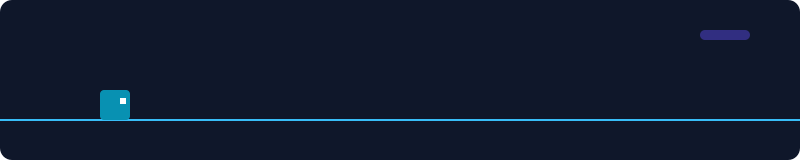

  

  

## 👨‍💻 Sobre mim

Estudante de **Ciência da Computação** na **Faculdade Dom Helder**, focado em **Data & Software**.

## 🎯 Áreas de interesse

- 📊 **Ciência de Dados**: análise de dados e Machine Learning
- 🤖 **Inteligência Artificial**
- 💻 **Desenvolvimento de Software**
- 🗄️ **SQL e modelagem de banco de dados**

## 🛠️ Tecnologias

  

## 🎮 Jogando enquanto você lê

  

## 🐍 Contribuições

  <picture>
    <source media="(prefers-color-scheme: dark)" srcset="https://raw.githubusercontent.com/ge212/ge212/output/github-contribution-grid-snake-dark.svg" />
    <source media="(prefers-color-scheme: light)" srcset="https://raw.githubusercontent.com/ge212/ge212/output/github-contribution-grid-snake.svg" />
    
  </picture>

